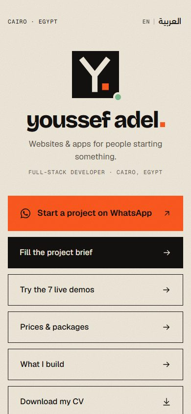
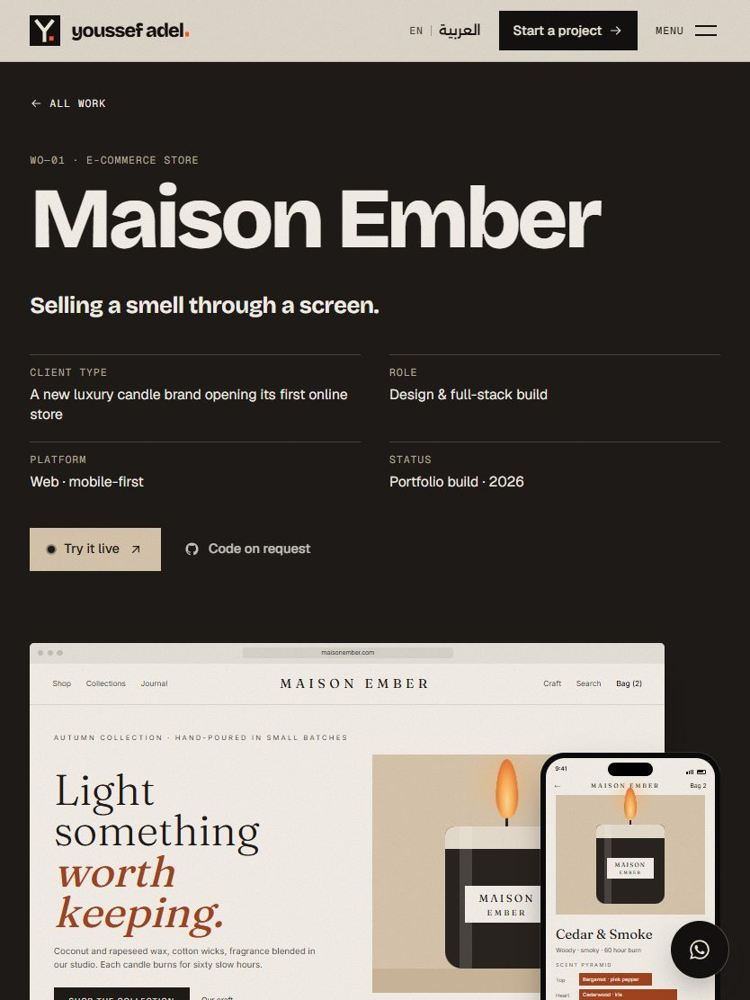
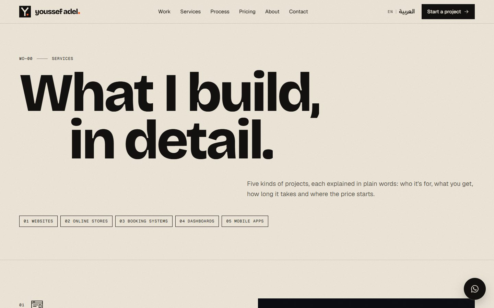
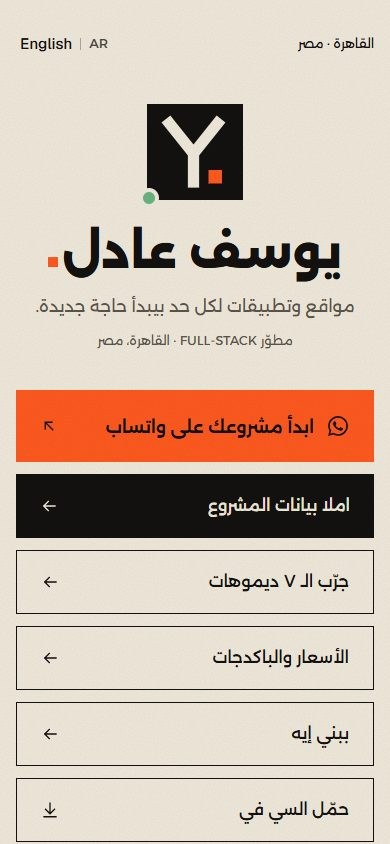
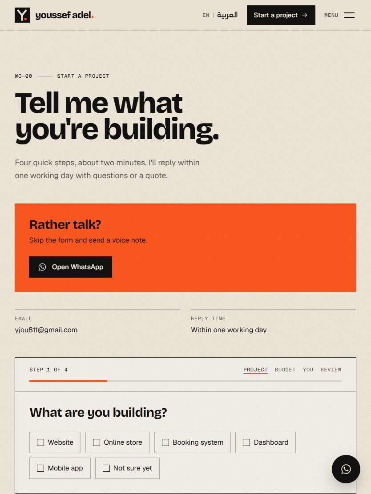
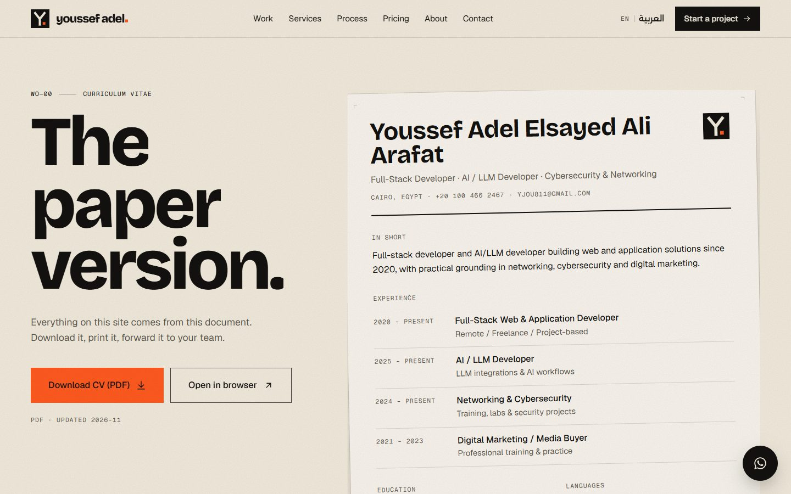

# youssef adel. — portfolio

The bilingual (English / Arabic) portfolio and sales site of **Youssef Adel**, full-stack developer in Cairo. Built to be the link in a TikTok bio: understand the offer in ten seconds, reach WhatsApp in one tap.

Art direction: **"The Build Sheet"**. Warm paper, oversized Bricolage Grotesque, kiln orange and Nile green color blocks, numbered work orders and crop marks. See [`ART-DIRECTION.md`](ART-DIRECTION.md) and [`brand/BRAND.md`](brand/BRAND.md).


## What's inside

| Page | Route |
| --- | --- |
| Home: hero, services, seven showcase builds, pinned process, pricing (packages, value breakdown, comparison, estimate builder), about, FAQ, CTA | `/en`, `/ar` |
| Case studies ×7 (problem, approach, design system, screens, features, stack, results) | `/en/work/<slug>` |
| **Live demos ×7**: working apps with sample data (store, QR menu, SaaS site, booking, real estate, dashboard, finance app) | `/en/demo/<slug>` |
| Services in detail + add-ons | `/en/services` |
| Start a project: 4-step brief form with progress, zod, honeypot, WhatsApp fallback | `/en/contact` |
| CV page with PDF download | `/en/cv` |
| Link-in-bio hub for TikTok | `/en/links` |
| Bilingual 404 | any unknown URL |

Every page has an Arabic twin under `/ar` with real RTL, generated Open Graph images, canonical + hreflang metadata, a sitemap entry and JSON-LD (Person + ProfessionalService) on the home page.

**Stack:** Next.js 16 (App Router) · TypeScript · Tailwind CSS 4 · GSAP + ScrollTrigger · Lenis · Framer Motion (contact form only) · zod · Resend · `next/og`.

All project mockups are drawn in code (HTML/CSS/SVG) in each build's own palette and typefaces — no screenshots. Every build also has a working live demo a visitor can click through, with a desktop / phone preview toggle.

Live site: https://youssef-portfolio-pi.vercel.app

## Run it

```bash
npm install
npm run dev        # http://localhost:3000
```

Production:

```bash
npm run build
npm start
```

Checks: `npm run lint` and `npx tsc --noEmit` (both run clean).

> Windows note: if `npm install` complains about `--allow-scripts`, the `allowScripts` field in `package.json` already covers the packages that need install scripts.

## Edit everything from one file: `src/config/site.ts`

| What | Where in `site.ts` |
| --- | --- |
| Name, email, phone, city | `person` |
| WhatsApp number (digits only, international format) | `person.whatsapp` |
| TikTok / Instagram / GitHub / LinkedIn | `socials` (empty = hidden everywhere) |
| Own deployment + GitHub URL of each build (optional) | `projects["maison-ember"].liveUrl`, `.githubUrl`, … |
| Package prices, care plan, add-ons, deposit share | `pricing` |
| Prices (EGP + USD) and delivery days | `pricing.packages` |
| Default currency shown | `pricing.defaultCurrency` |
| CV file | `cv.file` (replace `public/cv/youssef-adel-cv.pdf`) |

### Live demos and project URLs

Every build already has a working demo at `/demo/<slug>` (code in `src/components/demos/`). If you deploy a build on its own, paste its URLs and the "Try it live" button switches to it:

```ts
projects: {
  "maison-ember": { liveUrl: "https://maison-ember.vercel.app", githubUrl: "https://github.com/yousefadel0/maison-ember" },
  // …
}
```

Until `githubUrl` is filled, the site shows "Code on request" instead of a dead link. If a build ends up with different colors or fonts than planned, update its file in `src/content/projects/`.

### Copy and content

- UI text: `src/content/copy/en.ts` and `src/content/copy/ar.ts` (typed — a missing Arabic string is a compile error).
- Projects: `src/content/projects/*.ts` · Services: `src/content/services` · FAQ: `src/content/faq`.

## Contact form email

Copy `.env.example` to `.env.local`:

```
NEXT_PUBLIC_SITE_URL=https://your-domain.com
RESEND_API_KEY=re_...
CONTACT_TO_EMAIL=you@example.com
CONTACT_FROM_EMAIL=Portfolio <hello@your-domain.com>
```

Without a Resend key, briefs are printed to the server console, so the form never breaks.

## Deploy to Vercel

1. Import this repository in Vercel (framework preset: Next.js, root directory: repository root).
2. Add the environment variables above in **Project → Settings → Environment Variables**.
3. Deploy, then add your domain and set `NEXT_PUBLIC_SITE_URL` to it.
4. Put `https://your-domain.com/links` (or the home URL) in the TikTok bio.

## Project structure

```
brand/                 logo SVGs + BRAND.md
public/{cv,fonts,images}
screenshots/           mobile / tablet / desktop, English and Arabic
src/app/[locale]/      routes (root layout lives here so <html lang dir> is right)
src/components/        ui · layout · sections · motion · case-study (code-built mockups) · demos (live apps)
src/config/site.ts     the one file to edit
src/content/           copy (en/ar), projects, services, faq
src/lib/               i18n, seo, og, fonts, gsap loader, contact schema
src/proxy.ts           sends / to /ar or /en by browser language
```

## Screenshots

| Mobile | Tablet | Desktop |
| --- | --- | --- |
|  |  |  |
|  |  |  |

More in [`screenshots/`](screenshots).

## Docs

[`INTAKE.md`](INTAKE.md) — what the CV and the five briefs say · [`ART-DIRECTION.md`](ART-DIRECTION.md) · [`DECISIONS.md`](DECISIONS.md) — every judgment call and placeholder · [`brand/BRAND.md`](brand/BRAND.md)
